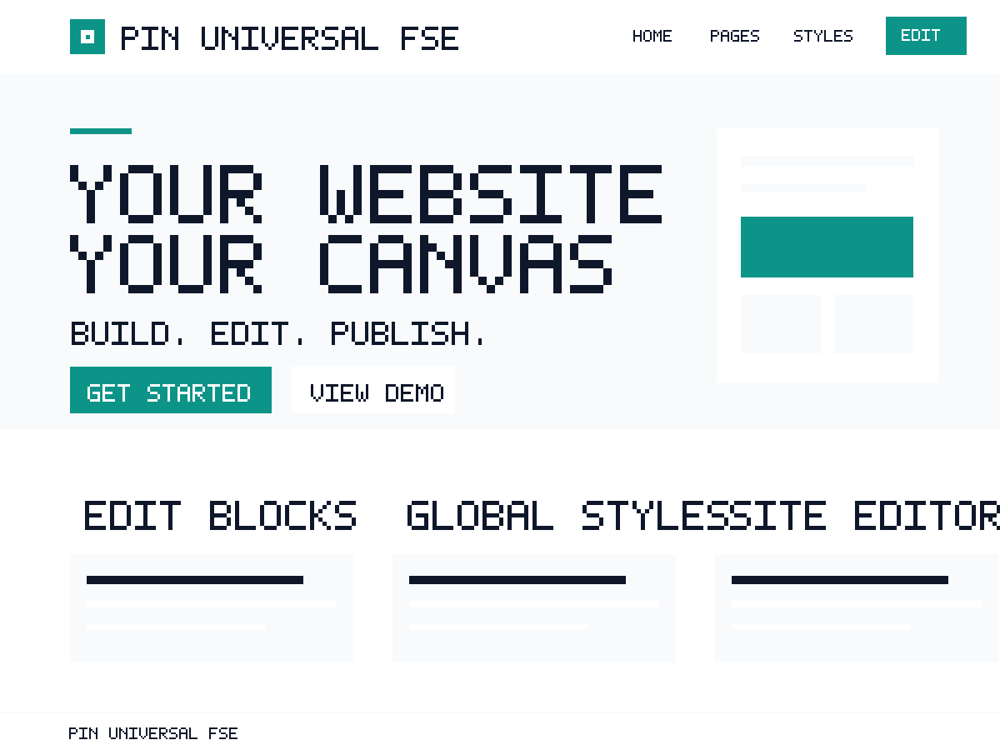
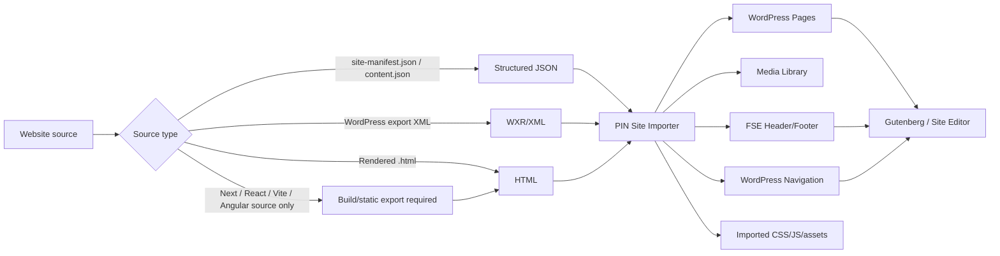
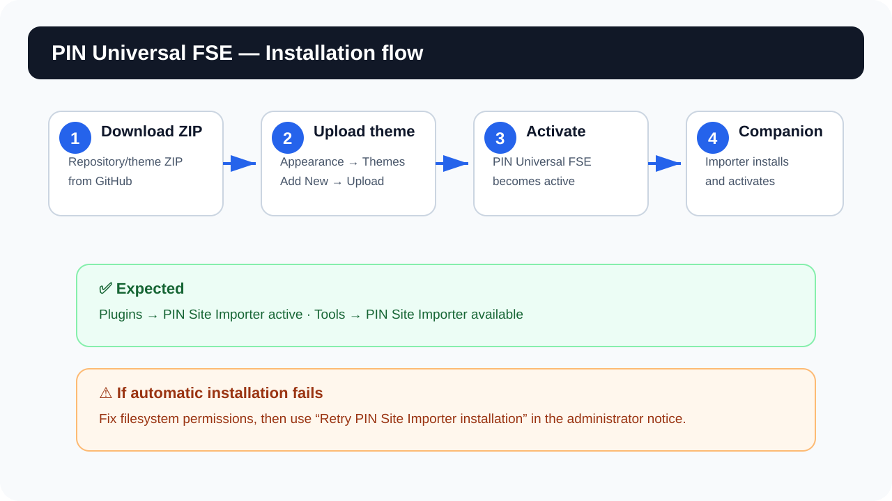
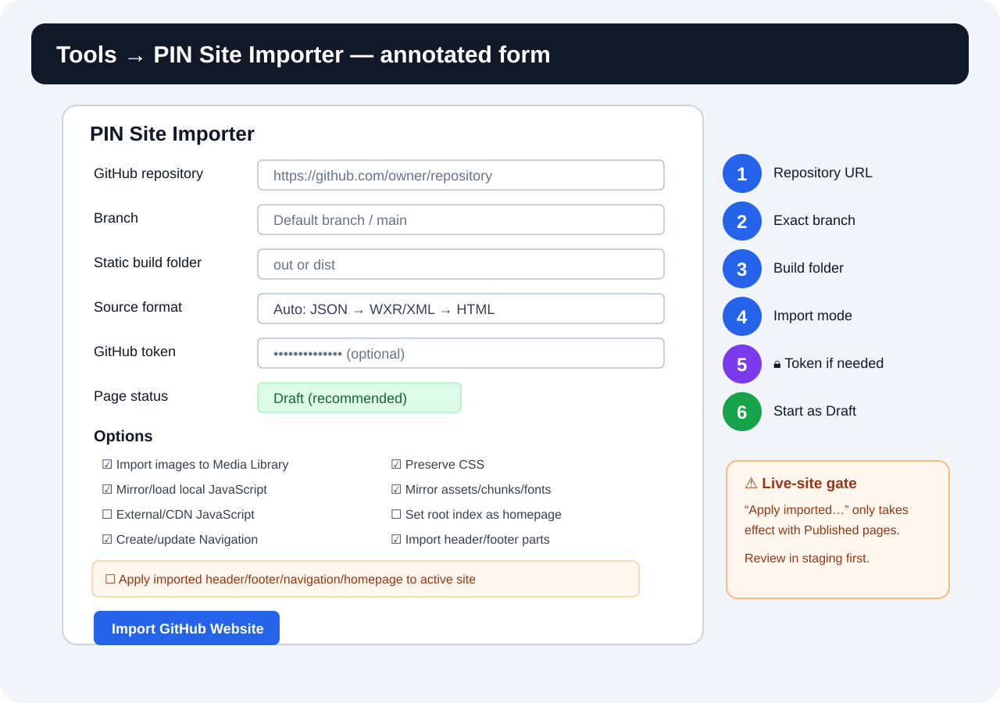
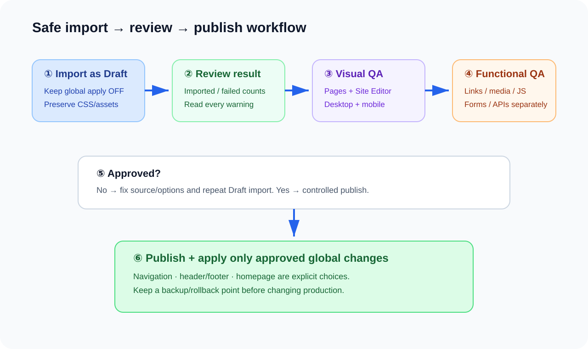
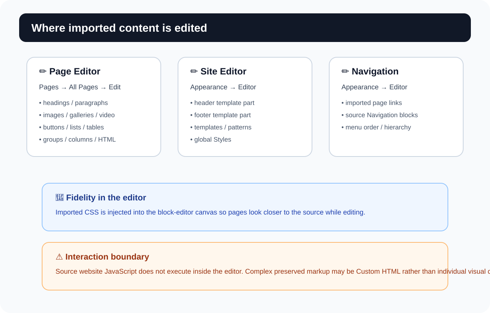
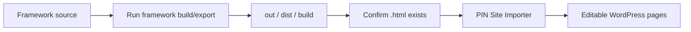
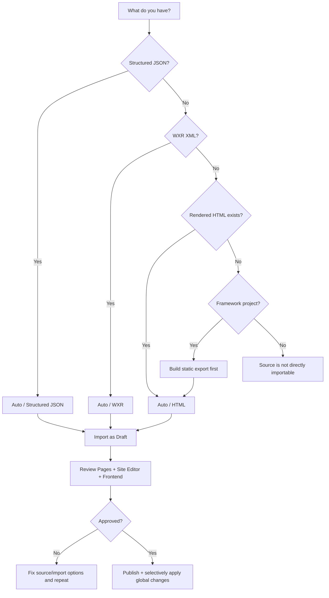

# PIN Universal FSE — Complete Visual Installation, Import & Editing Guide

> **Theme:** PIN Universal FSE 0.4.1  
> **Companion:** PIN Site Importer 0.4.1  
> **Requirements:** WordPress 6.6+ · PHP 8.1+ · Administrator access  
> **Repository:** https://github.com/omarreact/WpBlockThemeFSE

This guide documents the **actual behavior of the current codebase**. It covers theme installation, the bundled importer, source selection, GitHub/private-repository usage, Gutenberg/FSE editing, re-imports, structured build mode, validation, and troubleshooting.

## Visual indicator legend

| Indicator | Meaning |
|---|---|
| **① ② ③** | Perform these actions in order |
| **✅ Recommended** | Safe/default choice for first import |
| **⚠ Review** | Can change live output or load remote code |
| **🔒 Security** | Sensitive or permission-related setting |
| **🧪 Staging** | Validate here before production |
| **↪ Result** | Expected result after the action |
| **✏ Editable** | Editable in Gutenberg/Site Editor |
| **🧩 Custom HTML** | Preserved markup; not every property has a visual control |

---

## 1. What PIN Universal FSE does

PIN Universal FSE is a **content-neutral native WordPress block theme**. The repository also bundles the **PIN Site Importer** plugin.

The two components have different responsibilities:

| Component | Responsibility |
|---|---|
| **PIN Universal FSE theme** | FSE templates, header/footer parts, Navigation, global styles, `theme.json`, Gutenberg editing |
| **PIN Site Importer plugin** | Inspect source repository, select import mode, import pages/media/assets, convert HTML to blocks, create/update FSE parts and Navigation |
| **Structured Build Mode** | Offline/build-time conversion to a standalone generated FSE theme ZIP + WXR XML |



### Architecture



**Important boundary:** the importer consumes **rendered/static output**. It does not rebuild a framework backend, authentication, databases, server APIs, or arbitrary application logic.

---

## 2. Install the theme and companion importer



### 2.1 Before installation

Confirm:

- WordPress **6.6 or newer**.
- PHP **8.1 or newer**.
- You are logged in as a WordPress **Administrator**.
- The server can make outbound HTTPS requests to GitHub.
- WordPress can write to `wp-content/plugins` if you want automatic companion installation.
- 🧪 For a new importer workflow, use a staging/fresh WordPress site first.

### 2.2 Install

1. Download the repository/theme ZIP.
2. In WordPress open **Appearance → Themes → Add New → Upload Theme**.
3. Upload the ZIP and choose **Install Now**.
4. Activate **PIN Universal FSE**.
5. On the first eligible administrator request, the theme copies/updates the bundled **PIN Site Importer** into `wp-content/plugins` and activates it.
6. Open **Tools → PIN Site Importer**.

### 2.3 If automatic companion installation fails

The theme contains a filesystem-permission fallback. An administrator notice exposes:

**Retry PIN Site Importer installation**

Use that retry action after fixing filesystem ownership/permissions.

↪ **Expected result**

- **Appearance → Themes:** PIN Universal FSE is active.
- **Plugins:** PIN Site Importer is active.
- **Tools:** PIN Site Importer menu exists.

---

## 3. The importer screen — every field explained



Open **Tools → PIN Site Importer**.

### Import source fields

| # | Field | Use it for | Recommended first-import value |
|---|---|---|---|
| **①** | **GitHub repository** | Public or private GitHub repository URL | Repository root URL |
| **②** | **Branch** | Import an explicit branch/tag-like branch ref | Leave empty for default branch; set explicitly when reproducibility matters |
| **③** | **Static build folder** | `out`, `dist`, `build`, `public`, `site`, `docs` etc. | Leave empty if HTML is at root; set for framework exports |
| **④** | **Source format** | Auto / Structured JSON / WXR/XML / Rendered HTML | **Auto** |
| **⑤** | **GitHub token** | Private repository or metadata API rate limits | Empty for public repositories |
| **⑥** | **Imported page status** | Draft review vs immediate publish | **Draft** |

### Source-format behavior

**Auto** resolves in this order:

1. **Structured JSON** — `site-manifest.json` / `content.json`
2. **WordPress WXR/XML**
3. **Rendered HTML**

Use an explicit mode only when you need to force one format or diagnose source detection.

### GitHub token behavior 🔒

- Required for private repositories.
- Can also help when the server IP is rate-limited for GitHub metadata/tree discovery.
- The current importer treats the token as **request-only** and does **not persist it**.
- Public file bodies are fetched from GitHub raw content where possible.

---

## 4. Import options — what each checkbox changes

The current UI contains these options:

| Option | Default | What it does | When to disable |
|---|---:|---|---|
| **Import repository images into Media Library** | ✅ On | Sideloads referenced repository images into WordPress | If you intentionally want remote/static references |
| **Preserve referenced repository CSS** | ✅ On | Imports page CSS, embedded critical CSS and safe inline styles | Only for content-only migration |
| **Mirror and load repository JavaScript** | ✅ On | Mirrors referenced local classic/module scripts | Disable to isolate layout/content from JS behavior |
| **Mirror safe static build assets/chunks/fonts** | ✅ On | Copies allowed static dependencies into uploads | Disable for a minimal content-only import |
| **Load external/CDN JavaScript** | ⬜ Off | Loads remote JS from external origins | Enable only for a repository you trust |
| **Set root index.html as WordPress homepage when applying globally** | ⬜ Off | Assigns imported root home page | Enable only after confirming the imported home page |
| **Create/update WordPress Navigation** | ✅ On | Generates Navigation from imported pages | Disable when keeping an existing hand-managed menu |
| **Import source header/footer as editable FSE template parts** | ✅ On | Creates database-backed editable header/footer | Disable if source chrome should not become global parts |
| **Apply imported header/footer/navigation/homepage to active site** | ⬜ Off | Activates imported global site composition | ⚠ Only after staging review and only with Published import |

### Safety gate

The code applies global header/footer/navigation/homepage changes only when:

- **Imported page status = Publish**, and
- **Apply imported header/footer/navigation/homepage = checked**.

If global application is requested while importing as Draft, the importer intentionally does not apply it and returns a warning.

---

## 5. Recommended safe first import



Use this sequence for a new site:

1. **Repository:** enter the GitHub URL.
2. **Branch:** set the exact branch if known.
3. **Static build folder:** set `out` / `dist` only when required.
4. **Source format:** **Auto**.
5. **Page status:** **Draft**.
6. Keep Media, CSS, local JavaScript, static assets, Navigation and Template Parts enabled.
7. Keep **External/CDN JavaScript** disabled unless required.
8. Keep **Set homepage** disabled.
9. Keep **Apply imported…** disabled.
10. Click **Import GitHub Website**.
11. Review the result banner and warnings.
12. Review imported Pages, header/footer, Navigation, Media Library and responsive frontend.
13. When approved, run a controlled Published import and enable only the global options you actually want.

This provides a clean separation between **content ingestion** and **live-site activation**.

---

## 6. Reading the import result

A successful run reports:

- pages imported,
- pages failed,
- media files added,
- scripts mirrored,
- static assets mirrored,
- repository,
- branch,
- detected technology.

Warnings are displayed separately. Do not ignore them merely because the import itself completed.

### Common warning meanings

| Warning pattern | Meaning / action |
|---|---|
| **Automatically selected the detected static build folder** | The importer found a clear build root. Verify it is the intended export. |
| **Global changes were not applied because imported pages are drafts** | Expected safety behavior; publish and explicitly enable global application only after review. |
| **Repository contains more than 75 HTML pages** | Runtime importer processes only the first batch of 75. Use a smaller source set or Structured Build Mode for a larger deterministic conversion. |
| Asset/CSS/script fetch warning | Inspect the missing path, permissions, MIME type, build output and source URL. |
| No importable HTML | The project likely needs a static build/export first, or the build folder is wrong. |

---

## 7. Which source type should I use?

| Source | Can runtime importer use it directly? | Best path |
|---|---:|---|
| Plain HTML/CSS/JS repository | ✅ | Auto or Rendered HTML |
| Static exported Next.js | ✅ | Point **Static build folder** to `out` |
| Vite/React static build | ✅ | Usually `dist` |
| Angular static build | ✅ | Point to generated HTML output |
| Next.js/React source with no built HTML | ❌ | Build/export first |
| `site-manifest.json` / `content.json` | ✅ | Auto or Structured JSON |
| WordPress export XML | ✅ | Auto or WXR/XML |
| Dynamic API/backend/auth application | ❌ as a full application | Rebuild backend integration separately |
| Private GitHub repository | ✅ | Temporary token required |
| Very large structured site | ✅ with build-time path | Structured Build Mode |

### Runtime page limit

The runtime importer currently caps an import run at **75 HTML pages**.

### Structured Build Mode scale

The structured builder validates explicit hierarchy and fails on invalid/oversized structures rather than silently flattening them; the current structured contract treats **more than 250 pages** as an error.

---

## 8. What becomes editable in WordPress?



### ✏ Pages

Open **Pages → All Pages → Edit**.

The converter creates native core blocks for supported content such as:

- headings,
- paragraphs,
- images and galleries,
- lists,
- quotes,
- tables,
- buttons,
- details,
- audio/video,
- responsive column-like groups,
- structural groups,
- navigation.

### ✏ Header and footer

Open **Appearance → Editor → Design / Patterns / Template Parts** (exact Site Editor labels vary by WordPress version).

Imported source header/footer can become database-backed FSE template parts. The importer protects user-managed FSE header/footer customizations: it updates importer-owned parts for the same repository instead of blindly overwriting unrelated user-managed parts.

### ✏ Navigation

Open **Appearance → Editor → Navigation**.

When enabled, the importer creates/updates WordPress Navigation from imported pages while preserving source-provided Navigation blocks where applicable.

### ✏ Global styles

Open **Appearance → Editor → Styles**.

The theme's `theme.json` provides global typography, colors, spacing, dimensions and editor design tools.

### 🧩 Complex source markup

Markup that cannot be safely represented as native blocks may remain **Custom HTML**. It is still editable, but not every source property becomes an individual visual control.

### CSS and JavaScript inside the editor

- Imported CSS is injected into the Gutenberg/Site Editor canvas to improve visual fidelity.
- Source website scripts are **not executed inside the editor canvas**.
- Therefore a dynamic UI may look editable but only become interactive on the frontend.

---

## 9. Header/footer behavior and standalone pages

The importer can extract shared source header/footer into FSE template parts so they are not duplicated in every page.

Structured pages can also declare:

```json
{
  "template": "standalone"
}
```

A standalone page preserves its own source header/footer and uses the independent source-page template. This is useful for alternate homepages, campaign pages, landing pages or deliberately different layouts.

---

## 10. Re-import behavior

The runtime importer upserts imported pages using source metadata tied to:

- repository,
- branch,
- source path.

That avoids blindly creating a duplicate page on every run.

However, a re-import can update importer-owned page content and imported template parts. Therefore:

1. Back up important manual edits.
2. Keep a staging copy.
3. Re-import the same branch/source path only when you intend to synchronize from source.
4. Verify user-managed header/footer/template changes after any broad migration.

---

## 11. Private repository workflow 🔒

1. Generate a GitHub token with the minimum repository read permission needed.
2. Open **Tools → PIN Site Importer**.
3. Enter the private repository URL.
4. Enter the intended branch.
5. Paste the token into **GitHub token (optional)**.
6. Import.
7. Do not store the token in page content, documentation, screenshots or support tickets.

The importer is designed to use the token only for that request, including authenticated repository asset retrieval.

---

## 12. Framework workflow: Next.js / React / Vite / Angular

The importer does **not** interpret application source code as a rendered site.

### Correct flow



Examples:

- Next.js static export → `out/`
- Vite → usually `dist/`
- Other generators → choose the directory containing the final rendered HTML

If there is no rendered `.html`, do not expect the importer to reconstruct the application's runtime automatically.

---

## 13. Structured JSON workflow

Auto mode prefers structured JSON when the expected files exist.

Typical files:

- `site-manifest.json` or `manifest.site.json`
- `content.json` or `site-content.json`
- optional `design-tokens.json`, `tokens.json`, `theme-tokens.json`

Structured metadata can describe page paths, hierarchy, content, SEO hints, header/footer, and design tokens while still flowing through the Gutenberg/FSE conversion pipeline.

For a **public structured repository with an explicit branch**, the importer can probe known structured files using raw GitHub content before full repository tree inspection, reducing metadata API dependency.

---

## 14. WordPress WXR/XML workflow

Use WXR when the source is already a WordPress export.

The importer supports pages/posts plus applicable hierarchy, public custom fields, categories and tags.

Use:

- **Source format: Auto** if the repository contains the export and you want automatic selection.
- **Source format: WordPress WXR/XML** when you want to force WXR and receive a clear error if no export exists.

---

## 15. Structured Build Mode — generate a standalone theme + WXR

This is a separate build-time workflow. The generated site does **not** require PIN Site Importer or runtime GitHub access for local generated assets.

### Build

```bash
python scripts/build-structured-site.py --source-root /path/to/source --out-dir build/my-site
```

Requires Python 3.10+ and uses the standard library.

Outputs include:

- generated installable FSE theme ZIP,
- `website.xml` WXR,
- theme-owned source assets,
- `pin-build.json`,
- `build-report.json`.

### Install generated output on staging

1. Install and activate the generated theme ZIP.
2. Open **Tools → Import → WordPress**.
3. Import `website.xml`.
4. Select the imported Home page as the static front page.
5. Choose the desired permalink structure.
6. Review `build-report.json`.
7. Test desktop/mobile design, menus, media, forms, dynamic scripts and editor save/reload.
8. Only then promote to production.

Structured Build Mode is the better path when you need a deterministic standalone package rather than runtime GitHub importing.

---

## 16. Use-case recipes

### Use case A — import a simple HTML website

**Settings**

- Source format: Auto
- Page status: Draft
- Media/CSS/JS/assets: On
- External JS: Off
- Navigation: On
- Template parts: On
- Apply global: Off

**Review:** pages, typography, header/footer, internal links, mobile.

### Use case B — import a Next.js static export

**Settings**

- Repository: Next.js repo
- Branch: exact tested branch
- Static build folder: `out`
- Source format: HTML or Auto
- First pass: Draft

**Requirement:** `out` must already exist in the repository.

### Use case C — private client repository

**Settings**

- Temporary read token
- Exact branch
- Draft
- External JS off unless reviewed

**Security:** token is request-only; never document it.

### Use case D — replace a staging site's complete visual shell

After a successful Draft review:

- Page status: Publish
- Import template parts: On
- Create/update Navigation: On
- Set homepage: On if root index is correct
- Apply imported header/footer/navigation/homepage: On

⚠ This is the setting combination that can intentionally change the active site composition.

### Use case E — preserve the current global header/footer

- Import template parts: Off, or
- Keep Apply global: Off

Import page content first and integrate global chrome manually.

### Use case F — alternate/independent landing page

Use Structured JSON with `"template": "standalone"` when that page must preserve its own complete source header/footer rather than inherit the shared FSE shell.

---

## 17. Troubleshooting

| Problem | Check | Resolution |
|---|---|---|
| **PIN Site Importer menu missing** | Plugin activation / filesystem | Use admin retry notice; verify `wp-content/plugins` write permissions |
| **No importable .html files** | Build output | Build/export framework and set correct static folder |
| **GitHub 403/429 / metadata failure** | GitHub API rate limit | Set explicit branch; use token if required; structured public repos can use raw fast path |
| **Private images missing** | Token + import media | Use a token with repository read access and keep media import enabled |
| **Layout looks unstyled** | CSS option / missing referenced CSS | Keep CSS import enabled; inspect warnings and source asset paths |
| **JS interaction missing** | Local JS/external JS | Keep local JS enabled; enable external/CDN JS only for trusted dependencies |
| **Editor looks different from frontend** | Script-driven UI | CSS is loaded in editor, source JS is not executed there |
| **Homepage did not change** | Draft/global safety gate | Publish + enable Set homepage + Apply imported… only after review |
| **Header/footer did not become global** | Template parts/global apply | Import template parts and explicitly apply global composition |
| **Existing custom header/footer stayed unchanged** | Protection behavior | Expected when parts are user-managed rather than importer-owned |
| **More than 75 pages** | Runtime cap | Split import or use Structured Build Mode |
| **A complex widget is Custom HTML** | Conversion safety | Edit markup directly or replace it with a native/custom block implementation |
| **Dynamic login/API feature does not work** | Static import boundary | Rebuild/connect the backend separately; importer is not an app-runtime converter |

---

## 18. Production validation checklist

Before moving an imported site to production, verify all of the following:

- [ ] Theme and companion versions match.
- [ ] Import completed with **0 unexpected failures**.
- [ ] Every warning was reviewed.
- [ ] Desktop layout verified.
- [ ] Mobile layout verified.
- [ ] Header/footer verified.
- [ ] Navigation and dropdowns verified.
- [ ] Homepage assignment verified.
- [ ] Internal links verified.
- [ ] Images and downloads verified.
- [ ] Fonts and CSS assets verified.
- [ ] Local scripts verified.
- [ ] External/CDN scripts reviewed and trusted.
- [ ] Forms tested end-to-end.
- [ ] Authentication/API features tested separately.
- [ ] Gutenberg page editing tested.
- [ ] Site Editor header/footer editing tested.
- [ ] Save → reload → frontend rendering tested.
- [ ] Backup/rollback point exists.
- [ ] Staging validation completed on hosting similar to production.

A successful ZIP install or HTTP 200 response is **not** sufficient validation for full visual/functionality parity.

---

## 19. Quick decision map



---

## 20. Source-of-truth files for maintainers

When behavior changes, update this guide together with the implementation:

- `README.txt`
- `plugin/pin-site-importer/includes/class-pin-admin.php`
- `plugin/pin-site-importer/includes/class-pin-importer.php`
- `plugin/pin-site-importer/includes/class-pin-structured-source.php`
- `plugin/pin-site-importer/includes/class-pin-html-to-blocks.php`
- `plugin/pin-site-importer/includes/class-pin-asset-manager.php`
- `inc/companion-plugin-installer.php`
- `docs/structured-build-mode.md`
- `theme.json`

---

### Recommended operating rule

**Import → Review → Edit → Test → Publish → Apply global composition.**

Do not make **Publish + Apply imported…** the first test of an unfamiliar repository.
